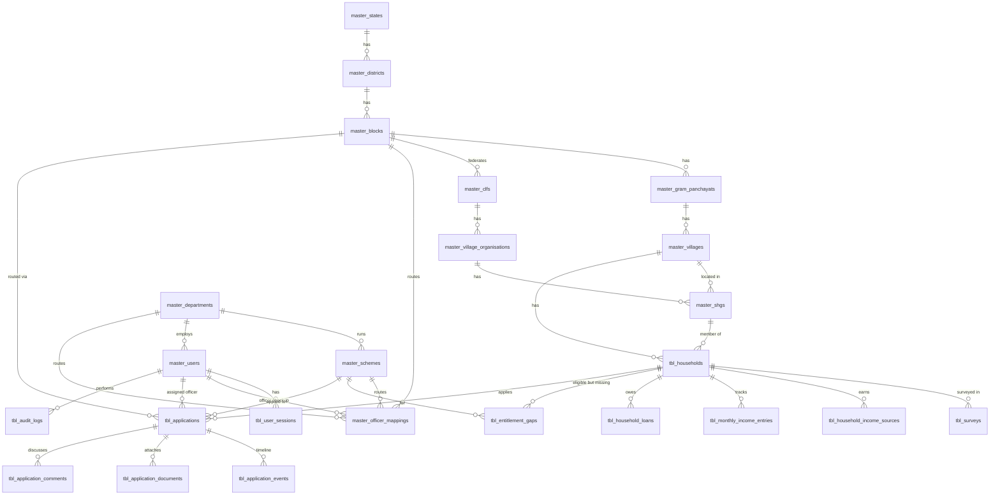

# Database design — Lakhpati Didi portal

MySQL 8 / MariaDB 10.4+ · `utf8mb4_unicode_ci` · InnoDB · strict SQL mode.

## Naming convention

| Prefix | Use for | Examples |
|---|---|---|
| `master_<name>` | Reference and configuration data that admins maintain and transactions point to | `master_villages`, `master_schemes`, `master_users` |
| `tbl_<name>` | Transactional and operational records created through day-to-day use | `tbl_households`, `tbl_applications`, `tbl_audit_logs` |
| `v_<name>` | Read-only views | `v_application_list` |

Table names are plural snake_case. Columns are snake_case, foreign keys are `<entity>_id`, and constraints use `fk_` / `uq_` / `ix_` / `ck_`. `schema_migrations` belongs to the migration runner and has no prefix.

## Entity–relationship diagram



## Tables by area

| Area | Tables | Notes |
|---|---|---|
| Geography | `master_states` → `master_districts` → `master_blocks` → `master_gram_panchayats` → `master_villages` | Codes are unique and stable (`BST`, `JGD`, `V-BADANJI`). |
| SHG federation | `master_clfs` → `master_village_organisations` → `master_shgs` | `lokos_code` holds the LokOS ID for imports. |
| Masters | `master_departments`, `master_schemes`, `master_survey_sections`, `master_option_lists` | A scheme has a category (livelihood / entitlement / credit / skill), a subsidy % and an SLA in days. |
| Access | `master_users`, `master_officer_mappings`, `tbl_otp_requests`, `tbl_user_sessions` | One role per user; scope is set by department / district / block / village. OTPs and session tokens are stored only as SHA-256 hashes. |
| Households | `tbl_households`, `tbl_surveys`, `tbl_household_income_sources`, `tbl_monthly_income_entries`, `tbl_household_loans`, `tbl_entitlement_gaps` | `current_annual_income`, `active_income_sources` and `lifecycle_status` on `tbl_households` are cached from the latest survey. `tbl_surveys.responses` holds the full form as JSON. |
| Applications | `tbl_applications`, `tbl_application_events`, `tbl_application_documents`, `tbl_application_comments` | `department_id` is copied from the scheme so department inboxes can filter quickly. Every status change writes an event row. |
| Audit | `tbl_audit_logs` | The API writes a row for every change and every login. |

### Application status lifecycle

```
submitted ─accept─▶ under_review ─sanction─▶ sanctioned ─deliver─▶ delivered
    │                   │  ▲
    │                   ▼  │ (CRP responds)
    └──────────────▶ info_requested
 any open status ─reject─▶ rejected
```

"Overdue" (अतिदेय) is not stored. It is worked out when read: the application is still open and `CURDATE() > sla_due_on`.
Escalation (`none → bdo → dpm → collector`) is stored separately from status.

### Views

- **`v_application_list`**: one row per application, with Didi, village, scheme, department, block, `days_pending` and `is_overdue`. All application lists use it.
- **`v_household_register`**: one row per household, with its SHG / VO / CLF and live counts of open applications and open entitlement gaps.

## Migrations

Files in `migrations/` run in name order. Each has a `-- migrate:up` and a `-- migrate:down` section, and applied versions are recorded in `schema_migrations`.

```bash
npm run db:migrate    # apply pending migrations (creates the database if missing)
npm run db:rollback   # undo the most recent migration
npm run db:seed       # load seeds/*.sql (only if master_users is empty)
npm run db:reset      # drop database → migrate → seed
npm run db:status     # ✓ applied / · pending
```

To add a change, create the next file (for example `006_add_village_facilities.sql`) with both sections, and follow the naming convention above. Never edit a migration that has already run on a shared database.

`seeds/001_demo_data.sql` loads the Bastar / Jagdalpur demo data from the Figma design: 17 households, 20 applications, 15 users, officer mappings, gaps and audit history. Seed dates are relative to `CURDATE()`, so "days pending" stays realistic.
