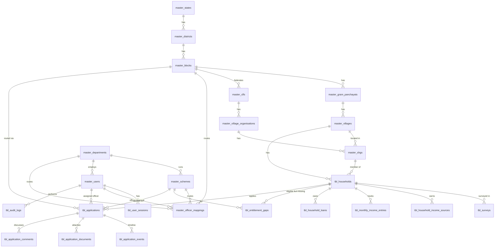

# Database design — Lakhpati Didi portal

MySQL 8 / MariaDB 10.4+ · `utf8mb4_unicode_ci` · InnoDB · strict SQL mode.

## Naming convention

| Prefix | Use for | Examples |
|---|---|---|
| `master_<name>` | Reference and configuration data that admins maintain and transactions point to | `master_villages`, `master_schemes`, `master_users` |
| `tbl_<name>` | Transactional and operational records created through day-to-day use | `tbl_households`, `tbl_applications`, `tbl_audit_logs` |
| `v_<name>` | Read-only views | `v_application_list` |

Table names are plural snake_case. Columns are snake_case, foreign keys are `<entity>_id`, and constraints use `fk_` / `uq_` / `ix_` / `ck_`. `schema_migrations` belongs to the migration runner and has no prefix.

## Entity–relationship diagram



## Tables by area

| Area | Tables | Notes |
|---|---|---|
| Geography | `master_states` → `master_districts` → `master_blocks` → `master_gram_panchayats` → `master_villages` | Codes are unique and stable (`BST`, `JGD`, `V-BADANJI`). |
| SHG federation | `master_clfs` → `master_village_organisations` → `master_shgs` | `lokos_code` holds the LokOS ID for imports. |
| Masters | `master_departments`, `master_schemes`, `master_survey_sections`, `master_option_lists` | A scheme has a category (livelihood / entitlement / credit / skill), a subsidy % and an SLA in days. |
| Access | `master_users`, `master_user_assignments`, `master_officer_mappings`, `tbl_otp_requests`, `tbl_user_sessions` | A user holds one or more role × area assignments (state, district, block, GP or village; department roles also name the department). `master_users.role` and its area columns mirror the first (primary) assignment. A session records the role it works as. OTPs and session tokens are stored only as SHA-256 hashes. |
| Households | `tbl_households`, `tbl_surveys`, `tbl_household_income_sources`, `tbl_monthly_income_entries`, `tbl_household_loans`, `tbl_entitlement_gaps` | `current_annual_income`, `active_income_sources` and `lifecycle_status` on `tbl_households` are cached from the latest survey. `tbl_surveys.responses` holds the full form as JSON. |
| Applications | `tbl_applications`, `tbl_application_events`, `tbl_application_documents`, `tbl_application_comments` | `department_id` is copied from the scheme so department inboxes can filter quickly. Every status change writes an event row. |
| Audit | `tbl_audit_logs` | The API writes a row for every change and every login. |
| Notifications | `master_notification_types`, `tbl_notifications`, `tbl_notification_recipients`, `tbl_push_subscriptions`, `tbl_notification_deliveries` | See *Notifications* below. |
| Village profiles | `tbl_village_profiles` | One per village (survey D3–D5 and resources), filled by a CRP. `responses` holds the answers as JSON. |
| Scheme interest | `tbl_scheme_interests` | A Didi's answer (asked / interested / not interested) when asked on her phone about a recommended scheme. One row per household and scheme, so she is never asked twice. |

### Application status lifecycle

```
submitted ─accept─▶ under_review ─sanction─▶ sanctioned ─deliver─▶ delivered
    │                   │  ▲
    │                   ▼  │ (CRP responds)
    └──────────────▶ info_requested
 any open status ─reject─▶ rejected
```

"Overdue" (अतिदेय) is not stored. It is worked out when read: the application is still open and `CURDATE() > sla_due_on`.
Escalation (`none → bdo → dpm → collector`) is stored separately from status.

### Views

- **`v_application_list`**: one row per application, with Didi, village, scheme, department, block, `days_pending` and `is_overdue`. All application lists use it.
- **`v_household_register`**: one row per household, with its SHG / VO / CLF and live counts of open applications and open entitlement gaps.

## Migrations

Files in `migrations/` run in name order. Each has a `-- migrate:up` and a `-- migrate:down` section, and applied versions are recorded in `schema_migrations`.

```bash
npm run db:migrate    # apply pending migrations (creates the database if missing)
npm run db:rollback   # undo the most recent migration
npm run db:reset      # drop database → migrate (empty, no demo data)
npm run db:admin -- <mobile> [name]   # add an admin login
npm run db:status     # ✓ applied / · pending
```

To add a change, create the next file (for example `006_add_village_facilities.sql`) with both sections, and follow the naming convention above. Never edit a migration that has already run on a shared database.

There is no seed step. The Bastar / Jagdalpur demo data from the Figma design (17 households, 20 applications, 15 users) lives in `e2e/fixtures/` and is loaded only into `*_test` databases by the e2e server (`migrate.ts fixtures` refuses any other database).

## Loading the real data (fresh database)

The app shows only real data, so a new database needs these steps, in order. Every step is safe to re-run.

```bash
# 1. Tables (also creates the database if it is missing)
npm run db:migrate

# 2. Chhattisgarh geography from LGD: 33 districts, 146 blocks, GPs, ~20,000 villages
npm run geo:lgd

# 3. The state's Potential Lakhpati Didi list: one household per Didi, plus her SHG
#    (needs step 2; takes a few minutes for 6.27 lakh rows)
npm run pld:import -- "Potential Lakhpati Didi 2026-27 (6.27 Lakh).xlsx"

# 4. Map boundaries (optional; without them the maps are empty)
S="LGD via indian_admin_boundaries (CC0)"; D=database/data/boundaries
npm run geo:boundaries -- --level district       --file $D/chhattisgarh-districts.geojson  --code-field DIST_LGD    --source "$S"
npm run geo:boundaries -- --level block          --file $D/chhattisgarh-blocks.geojson     --code-field BLOCK_LGD   --source "$S"
npm run geo:boundaries -- --level gram_panchayat --file $D/chhattisgarh-panchayats.geojson --code-field GP_LGD      --source "$S"
npm run geo:boundaries -- --level village        --file $D/chhattisgarh-villages.geojson   --code-field VILLAGE_LGD --source "$S"

# 5. The first admin login; the admin then adds everyone else under Admin → Users
npm run db:admin -- 9XXXXXXXXX "Admin name"
```

On a server that already has surveys, run `npm run survey:backfill-gaps` once after migration 017. It turns the section D answers of saved surveys into entitlement gaps, and is safe to re-run.

Check with `npm run db:status` (every migration ✓). After step 3 the dashboards show every Didi on record with 0 surveyed. Survey, application and income figures fill in as CRPs work in the app.

Each user gets one or more **role × area** assignments (`master_user_assignments`, migration 016): for example, a DPM for two districts, or a CRP for a few villages. At login the person picks one of their own roles, and data is limited to that role's areas.

### Potential Lakhpati Didi list

`npm run pld:import -- "<file>.xlsx"` loads the state's PLD workbook (columns: District, Block, Panchayat Name, Village Name, Potential Lakhpati Didi Name / Code, SHG Name / Code, Father / Spouse Name, Social Category) after `geo:lgd`. Each Didi becomes a `tbl_households` row keyed on `lokos_member_code`, and each SHG a `master_shgs` row keyed on `lokos_code`, with no VO yet. Re-running with a newer list updates rows in place.

LokOS spellings differ from LGD, so places are matched by name: districts by name or alias, and blocks by how many panchayat names they share. Panchayats and villages match exactly, then by a clearly-best close spelling (≥ 0.8 similarity), then by a unique village name elsewhere in the block. Anything still unmatched is added with no LGD code (codes `PGP…` / `PV…`) and listed in `<file> - new places.csv` for review. In the 2026-27 list (6,27,930 Didis), 91% matched an LGD village and 1,092 places were added.

### Notifications

```
master_notification_types ─┐   bilingual templates, priority, push TTL, answer buttons
                           ▼
tbl_notifications (1 per event: type + JSON parameters, dedupe_key)
        │ fan-out on write
        ▼
tbl_notification_recipients (1 per user: read / archived / answer)  ◀── inbox + badge
        │ × each active device
        ▼
tbl_notification_deliveries (push outbox: pending → sent / failed / gone / skipped)
        ▲
tbl_push_subscriptions (browser push endpoint + keys per device)
```

- **Rendered when read.** Events store the template parameters, not text, so a notice shows in Hindi or English.
- **Same transaction.** Producers call `notify()` inside their own transaction (transactional outbox): a notice exists only if the business change commits.
- **Idempotent.** `dedupe_key` is unique, so sweeps (for example the hourly overdue check) can re-run safely.
- **Fast reads.** The inbox uses keyset pagination on `ix_recipient_inbox`. The badge count is answered from the `ix_recipient_unread` index alone.
- **Delivery worker.** It runs in the API process and leases rows with a `claim_token`, because MariaDB 10.4 has no `SKIP LOCKED`. It retries after 1 min, 5 min, 30 min, 2 h and 12 h. It revokes a device when the push service answers 404/410, and it skips a push the user has already read in the app.
- **Answer buttons.** Phone alerts carry a random single-use token; only its SHA-256 hash is stored, in `action_token_hash`. Tokens expire after 14 days.
- **Retention.** Notices older than 180 days and finished deliveries older than 30 days are deleted.
- **Custom notices (`broadcast.message`).** Staff can write a notice for the levels below them, only inside their own area: admin → everyone (optionally one district); state → district, department, block, CRP, Didi; DPM → own district (optionally one block); block → its CRPs and Didis; CRP → Didis in her village. Department officers and Didis cannot send. Rows use `entity_type = 'broadcast'` with the text in `payload`, and recipients are fanned out with `INSERT … SELECT`. A sender may send at most 10 an hour. The rules live in `server/modules/notifications/broadcasts.rules.ts`.

